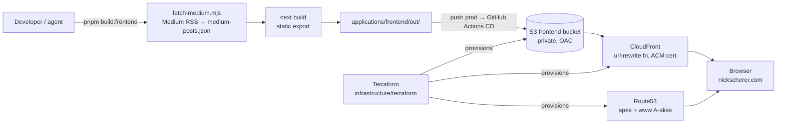

# ARCHITECTURE.md

Current-state map of nickscherer.com. **This is living documentation** — update it whenever routes, components, or infrastructure change.

Architecturally identical to nickordoodle.com, from which this repo was scaffolded ([ADR-0001](docs/adr/0001-scaffold-from-nickordoodle.md)); the deltas are content framing (resume vs. client portfolio), the dropped Services section, and the domain/state-bucket names.

## Routes

Single-route site (Next.js 14 App Router, static export):

| Route | Source | Notes |
|---|---|---|
| `/` | `applications/frontend/app/page.tsx` | The entire resume; a client component stacking all sections with in-page anchors (`#writing`, `#contact`, …) |
| 404 | Next default `_not-found` | No custom not-found page; CloudFront rewrites 404/403 → `/index.html` anyway |

`app/layout.tsx` holds all SEO metadata (title, description, OpenGraph, Twitter card) and loads Inter + JetBrains Mono from Google Fonts via `<link>`. `app/providers.tsx` provides a dark/light theme context persisted to `localStorage` (class-based, default dark).

## Components

One folder per section under `applications/frontend/components/`:

| Section | Components | Notes |
|---|---|---|
| nav | `Navigation` | Anchor nav + `ThemeToggle` |
| hero | `HeroSection`, `ParticleCanvas` | framer-motion intro over a custom canvas particle field; includes View/Download Resume CTAs (`/resume.pdf`) |
| about | `AboutSection` | |
| work | `WorkHistory` | Timeline from `lib/data.ts` roles |
| skills | `SkillsSection`, `SkillsRadar`, `CareerTimelineChart`, `TechBubbles`, `ImpactMetrics` | The three chart components use **echarts** via `echarts-for-react` (statically imported); `ImpactMetrics` uses framer-motion |
| projects / education / publications | one `*Section` each | Content from `lib/data.ts` |
| writing | `WritingSection` | Renders `lib/medium-posts.json`, generated at build by `scripts/fetch-medium.mjs` from the nickordoodle.medium.com RSS feed (same author, shared feed) |
| media | `MediaSection` | Filterable gallery — currently **placeholder items only**, no real assets |
| contact | `ContactSection` | LinkedIn / GitHub / avi.ai links; avatar is `public/images/avatar-placeholder.svg` |
| ui | `TiltCard`, `ScrollReveal`, `CursorSpotlight`, `ThemeToggle` | Shared primitives; `ScrollReveal` wraps framer-motion viewport reveals |

Library usage in short: **framer-motion** in `HeroSection`, `ImpactMetrics`, `ScrollReveal` (and via `ScrollReveal` everywhere); **echarts** only in the three `skills/` chart components; **lucide-react** icons throughout; `cn()` (clsx + tailwind-merge) in `lib/utils.ts`.

## Build output

`next.config.js` sets `output: 'export'`, `distDir: 'out'`, `images.unoptimized: true`. `pnpm build:frontend` runs `scripts/fetch-medium.mjs` (writes `lib/medium-posts.json`; writes `[]` on fetch failure) then `next build`, producing a fully static site in `applications/frontend/out/`. There is no server runtime.

## Infrastructure (`infrastructure/terraform/`)

Terraform ≥ 1.5, AWS provider ~> 5.0, state in S3 backend `nickscherer-terraform-state` (key `prod/terraform.tfstate`, us-east-1, lockfile). Root config wires two modules with env vars from `envs/prod.tfvars` (`env=prod`, `primary_domain=nickscherer.com`, `redirect_domain=""`):

- **`modules/frontend-cdn`** — private, versioned S3 bucket (`nickscherer-frontend-<env>-<account>`) fronted by CloudFront with Origin Access Control; ACM cert (us-east-1) for apex + `www` with automated Route53 DNS validation; a CloudFront Function rewriting extensionless URLs to `.html`/`index.html`; 404/403 → `/index.html`; Route53 A-alias records for apex and `www`.
- **`modules/redirect-cdn`** — optional (count-gated on `redirect_domain`, currently **disabled** since it's empty): S3 website redirect + CloudFront + ACM + Route53 to 301 a secondary domain to the primary.

Root outputs: `frontend_bucket`, `cloudfront_distribution_id` (for cache invalidation), `cloudfront_domain`.

**Infrastructure has not been applied yet** — the state bucket, hosted zone, and first `terraform apply` are pending owner actions (see [OPERATIONS.md](OPERATIONS.md) and the ROADMAP "⏸ Awaiting user" queue).

## CI/CD

- `.github/workflows/frontend-ci.yml` — lint/typecheck/build gate on push/PR to `dev` and `prod`.
- `.github/workflows/frontend-cd-prod.yml` — deploys on push to `prod` (build → `s3 sync` → CloudFront invalidation; see [OPERATIONS.md](OPERATIONS.md)). Non-functional until the AWS secrets exist.

## Build / deploy / serve flow

