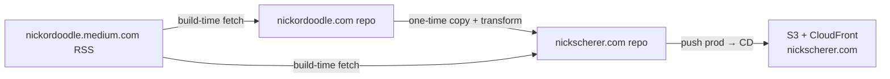

# ADR-0001: Scaffold nickscherer.com from nickordoodle.com

- **Status:** ✅ Done
- **Priority:** High
- **Scope:** M
- **Created:** 2026-07-18
- **Roadmap:** [ROADMAP.md](../../ROADMAP.md)

## Context

Nick wants two distinct web presences: **nickordoodle.com** as the client-facing creative portfolio (service offerings, client pitch) and **nickscherer.com** as the personal / professional resume. The owner directed that this repo use the **same exact architecture and frameworks** as nickordoodle.com, whose stack is proven end-to-end: Next.js 14 static export in a Lerna + pnpm monorepo, Tailwind CSS-variable theming, typed content in `lib/data.ts`, GitHub Actions CI/CD, and Terraform-managed S3 + CloudFront + ACM + Route53.

Owner decisions locked in before implementation: all sections except Services; full infra mirror now (owner applies Terraform / sets secrets later); repo under the `nickordoodle` GitHub account; same design system with content seeded from nickordoodle's `data.ts`.

## Decision

1. **Copy-and-transform, not scaffold-from-scratch.** The source repo is small and battle-tested (static-export quirks, ECharts client-only rendering, tiered S3 cache headers, ACM us-east-1 provider aliasing all solved); the rename surface is ~15 files.
2. Rename the workspace identity: root package `nickscherer.com`, frontend package `@nickscherer/frontend` (lockfile survives — pnpm keys importers by path).
3. **Drop the Services section**: `components/services/` deleted, nav link removed, `Service` interface and `services` export removed from `lib/data.ts`. All other sections (hero, about, work, skills, projects, education, publications, writing, media, contact) retained.
4. Retarget metadata (`app/layout.tsx`: URL → nickscherer.com, "Personal portfolio" → "Professional resume") and Terraform (`providers.tf` state bucket → `nickscherer-terraform-state`; `envs/prod.tfvars` `primary_domain` → `nickscherer.com`).
5. Rewrite the governance docs (README, AGENTS, ARCHITECTURE, OPERATIONS, ROADMAP, ADR index) for this repo; start a fresh ADR log with this record.
6. **Intentionally shared with nickordoodle.com** (same person): the Medium feed (`nickordoodle.medium.com` in `scripts/fetch-medium.mjs` and `WritingSection`), GitHub/LinkedIn/avi.ai contact links, all bio/role/education facts in `lib/data.ts`, and the entire design system.

**Non-goals.** No visual redesign; no new sections; no shared-package extraction between the two repos (tracked as a drift concern in ROADMAP); no infrastructure apply (owner-gated).

## High-Level Architecture

Identical to nickordoodle.com — see [ARCHITECTURE.md](../../ARCHITECTURE.md). Two independent repos with the same shape; no runtime or build-time coupling. The only cross-repo link is the shared Medium RSS feed fetched at build time.

## Data Model Changes

None — static site, no data stores. Content lives in `applications/frontend/lib/data.ts` (the `Service` interface and `services` array were removed; all other types unchanged).

## Implementation Details

- `rsync` copy excluding `node_modules`, `.git`, `.next`, `out`, `tsconfig.tsbuildinfo`, `infrastructure/terraform/.terraform`, `.claude/settings.local.json`; source ADRs 0001/0002 deleted (they document the other repo's decisions).
- Kept verbatim: `pnpm-lock.yaml`, `.terraform.lock.hcl`, both GitHub workflows (no hardcoded repo strings; secrets are repo-scoped), all Next/Tailwind/TS/ESLint/Prettier configs, both Terraform modules.
- Edits: root + frontend `package.json` (names/scopes), `app/page.tsx` + `components/nav/Navigation.tsx` (Services removal), `lib/data.ts` (Service type/data removal), `app/layout.tsx` (URL, description), `lib/medium-posts.json` (reset to `[]`), `infrastructure/terraform/providers.tf` + `envs/prod.tfvars` + `variables.tf` (bucket/domain), all root docs, `.claude/skills/verify/SKILL.md`.
- `redirect_domain` stays `""` — `www.nickscherer.com` is already covered inside the `frontend-cdn` module (cert SAN, CF alias, Route53 www record); `redirect-cdn` is only for redirecting a separate apex domain.
- Git: `dev` (default) + `prod` branches; repo `nickordoodle/nickscherer.com`.

## Consequences & Risks

- **Drift:** ~95% shared code with no sharing mechanism — fixes must land twice (ROADMAP item 10). Accepted at this scale.
- **Inherited gaps** carry over (no tests, SEO gaps, echarts bundle weight, placeholder avatar/media, `/resume.pdf` CTAs with no file behind them) — seeded into ROADMAP.
- **CD is non-functional until the owner bootstraps infra** (state bucket, hosted zone + NS delegation, `terraform apply`, four repo secrets — see OPERATIONS.md). A `prod` push before then fails at the AWS step; harmless but red.
- Terraform resource names match nickordoodle's — safe only because the state bucket differs; the backend must never point at `nickordoodle-terraform-state`.

## Verification

- `pnpm install` / `pnpm lint` / `pnpm typecheck` / `pnpm build:frontend` — see Implementation Log for results.
- Static export served locally and browser-verified via `.claude/skills/verify/`: sections render (no Services), theme toggle, charts, particles.
- `grep -ri nickordoodle` sweep — remaining hits limited to the intentional shared set (Medium feed/links, GitHub links, provenance mentions in docs).
- ⏸ Infra bootstrap + first deploy (owner) — tracked in OPERATIONS.md and ROADMAP.

## Implementation Log

- 2026-07-18 — Scaffolded per the decision above. Hero/About copy kept verbatim (already resume-toned, with View/Download Resume CTAs pointing at `/resume.pdf` — no such file exists yet; queued in ROADMAP "Awaiting user" for the owner to supply a PDF or drop the CTAs). One deviation from the copy plan: the original plan assumed both Terraform modules were verbatim-safe, but `modules/frontend-cdn` and `modules/redirect-cdn` had `nickordoodle` hardcoded into AWS resource names (S3 bucket name, OAC name, CloudFront function name, distribution comment, tags) rather than derived from `var.domain`. Left as-is, `terraform apply` would have provisioned nickscherer.com's infrastructure under nickordoodle-branded resource names. Fixed by renaming all hardcoded prefixes to `nickscherer-*` (caught by the post-copy `grep -ri nickordoodle` sweep, not by the original module review).
