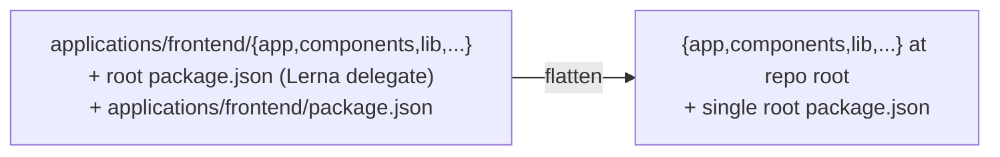

# ADR-0002: Flatten repo to a single package

- **Status:** ✅ Done
- **Priority:** High
- **Scope:** M
- **Created:** 2026-07-18
- **Roadmap:** [ROADMAP.md](../../ROADMAP.md)

## Context

[ADR-0001](0001-scaffold-from-nickordoodle.md) scaffolded this repo by copying nickordoodle.com's tree verbatim, including its Lerna 9 + pnpm-workspace monorepo shape (`applications/frontend/` as the sole workspace package, root scripts delegating through `lerna run --scope @nickscherer/frontend`). That shape earns its keep in nickordoodle.com if/when a second application joins the workspace, but nickscherer.com is scoped as a single resume site with no plan for additional apps — the monorepo layer was pure indirection (two `package.json`s, a `lerna.json`, a `pnpm-workspace.yaml`, and every path one level deeper than it needed to be) with no corresponding benefit. Owner flagged this directly after seeing the live repo.

## Decision

1. Move all frontend source (`app/`, `components/`, `lib/`, `scripts/`, `public/`, `next.config.js`, `tailwind.config.js`, `postcss.config.js`, `.eslintrc.json`, `next-env.d.ts`, `tsconfig.json`) from `applications/frontend/` to the repo root.
2. Merge `applications/frontend/package.json` into the root `package.json`: package name `nickscherer.com`, scripts become the plain Next.js scripts (`dev`, `build`, `start`, `lint`, `typecheck` — no more `build:frontend`/`dev:frontend` Lerna delegation), all frontend dependencies/devDependencies move to the root, the `pnpm.overrides` security block and `packageManager` pin are kept.
3. Delete `lerna.json` and `pnpm-workspace.yaml`; delete the now-empty `applications/` directory.
4. Update everything that referenced the nested path or the Lerna scripts: both GitHub workflows (`frontend-ci.yml` build step; `frontend-cd-prod.yml` paths filter, build step, and `out/` sync paths), `.vscode/launch.json` (program/cwd), `.claude/skills/verify/SKILL.md`, and all root docs (README, ARCHITECTURE, AGENTS, OPERATIONS, ROADMAP).

**Non-goals.** No change to the app's behavior, styling, or content — this is a pure repo-layout change. No change to the package manager (still pnpm) or to Terraform/infrastructure (unaffected by frontend source layout).

## High-Level Architecture

No architectural change to the running site — same Next.js static export, same S3/CloudFront/Terraform pipeline. The only shift is where source lives in the repo tree and how the root `package.json` invokes it.

## Data Model Changes

None — static site, no data stores. `lib/data.ts` content unchanged, only its path (`applications/frontend/lib/data.ts` → `lib/data.ts`).

## Implementation Details

- Stopped the running local dev server (it held file handles under the old `applications/frontend/` path) before moving files.
- `mv` the frontend subdirectories/files to root; deleted `applications/frontend/node_modules`, `.next`, `out`, `tsconfig.tsbuildinfo` before the move (build artifacts, not worth relocating); deleted the root's stale monorepo `node_modules` afterward for a clean reinstall.
- Root `tsconfig.json` (the old minimal CommonJS tooling config) replaced outright by the frontend's Next.js `tsconfig.json` (target es5, `@/*` path alias, Next plugin) — the old one had no remaining purpose once there's only one TypeScript project in the repo.
- `frontend-cd-prod.yml`'s `paths` filter, previously a single `applications/frontend/**` glob, became an explicit list of the flattened top-level dirs/files (`app/**`, `components/**`, `lib/**`, `public/**`, `scripts/**`, plus the individual config files) so it still scopes deploys to frontend-relevant changes rather than firing on every docs/infra push.
- `pnpm install`, `pnpm lint`, `pnpm typecheck`, `pnpm build` all re-run clean from the new root layout; static export served and browser-verified (nav, no Services/Media sections, theme toggle, all four canvases).

## Consequences & Risks

- **Divergence from nickordoodle.com's package layout widens**: that repo stays a Lerna/pnpm monorepo, this one is now flat. Component code between the two repos is no longer copy-paste compatible without adjusting import paths — noted in ROADMAP's drift-management item.
- **CD workflow's `paths` filter had to be hand-maintained as an explicit list** instead of one glob; a new top-level frontend directory added later needs a matching entry or CD silently won't trigger for it.
- Git history for the moved files is not preserved by a plain `mv` + re-add (no `git mv` used, since the working tree wasn't yet a git checkout at move time in the usual sense — files were moved before staging); acceptable for a repo this young.

## Verification

- `pnpm install` / `pnpm lint` / `pnpm typecheck` / `pnpm build` from the new root — all pass.
- Static export served locally and browser-verified: sections render correctly, no Services/Media nav entries, theme toggle works, all four canvases (particles + 3 charts) render.
- `git status` reviewed before staging to confirm the move didn't touch `.git`, `node_modules`, or leak anything unexpected.

## Implementation Log

- 2026-07-18 — Flattened per the decision above.
