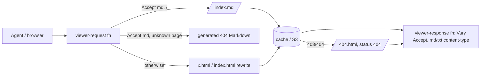

# ADR-0003: Make the site agent-ready (SEO basics, llms.txt, Markdown negotiation, real 404s)

- **Status:** 🟡 In progress (code done; live after promote + terraform apply)
- **Priority:** High
- **Scope:** M
- **Created:** 2026-11-18
- **Roadmap:** [ROADMAP.md](../../ROADMAP.md) — item 12 (owner-requested 2026-11-18); also closes item 3 (SEO gaps)

## Context

The owner asked for the site to score well on https://is-agentic.com and to serve a real `llms.txt`.
Baseline scan (2026-11-14, re-measured 2026-11-18): **55/100**. `robots.txt`, `sitemap.xml` and
`llms.txt` all returned the HTML fallback with 200, because CloudFront maps S3 403/404 →
`/index.html` with 200 (`modules/frontend-cdn/main.tf`). Failing checks: agent-friendly-404 (soft
404), markdown-negotiation-vary, agent-instruction, sitemap (missing), json-ld (none), org-schema
(n/a for a person), metadata-completeness (no canonical, no `og:image`), trust-anchors,
brand-search-accuracy (not top 10 for "Nick Scherer VP Engineering").

ROADMAP item 3 (robots, sitemap, favicon, OG image, `metadataBase`, JSON-LD) was the same gap,
inherited from nickordoodle.com, where it was closed by that repo's ADR-0003. This ADR mirrors that
fix here (see the drift item) and adds the agent-facing pieces that nickordoodle.com's ADR-0005
adds there, so the two sites stay in step.

## Decision

1. **SEO basics** (mirrors nickordoodle.com ADR-0003): `lib/site.ts` constants;
   `metadataBase` + `alternates.canonical` in `app/layout.tsx`; `app/sitemap.ts` (force-static, one
   URL, build-time `lastmod`); `app/icon.svg` (the shared "N" monogram); a typographic 1200×630
   share card, rendered once with `next/og` and committed as `app/opengraph-image.png` +
   `twitter-image.png` (a generated route exports an extensionless file that S3 would serve with
   the wrong content type).
2. **JSON-LD `Person`** with `name`, `url`, `description` (the existing meta description),
   `jobTitle`, `worksFor`, `homeLocation`, `alumniOf`, `knowsAbout` (terms on the page) and
   `sameAs` (LinkedIn, GitHub, Medium, the profile links already on the page). No Organization
   schema: this is a person's resume.
3. **Agent content generated from the page's own data:** `lib/agent-content.ts` builds
   `/llms.txt` (llmstxt.org format with `## When to use Nick Scherer`), `/llms-full.txt`,
   `/index.md` and `/404.md` from `lib/data.ts`, `lib/site.ts`, `lib/medium-posts.json`, emitted
   by `force-static` route handlers. `robots.txt` (route handler) allows everything, names the
   sitemap and points to `/llms.txt`.
4. **Edge (CloudFront Functions, `cloudfront-js-2.0`, code in `modules/frontend-cdn/functions/`):**
   viewer-request serves `/index.md` for `Accept: text/markdown` on `/`, generates a Markdown 404
   for other page-like paths, and otherwise keeps the original rewrite unchanged. viewer-response
   (new) appends `Vary: Accept` and sets `.md` / `.txt` content-types on 2xx/3xx.
5. **Real 404s:** 403/404 → `/404.html` with status **404** (was `/index.html` with 200).
6. **CD:** `*.txt`, `*.xml` and `*.md` join the `max-age=0, must-revalidate` sync group. Today
   only HTML/JSON do, so `robots.txt`, `sitemap.xml` and `llms.txt` would get the one-year
   immutable cache.
7. **Tests:** `functions/functions.test.js` (`node --test`, no deps; `pnpm test:edge`, in CI
   after the build) covers both functions and checks build parity (twins exist, edge 404 body ==
   `/404.md`, every sitemap URL has a twin).

**Non-goals.** No `/about`, `/contact` or `/privacy` pages (single-page site; no email/phone to
build a contact page from; privacy text is legal copy the owner must supply). No fact changes. No
`Accept` in the cache policy. No fix for the missing `/resume.pdf` (owner asset, already in ⏸).

**Alternatives considered.** Hand-written `public/*.md` (drifts from `lib/data.ts`); Lambda@Edge
(unnecessary); static `public/robots.txt` + `sitemap.xml` (equivalent, but the route handlers keep
the URL in one constant).

## High-Level Architecture

Same as nickordoodle.com ADR-0005:

## Data Model Changes

None (static site; no stores).

## Implementation Details

Files: `lib/{site,agent-content}.ts`, `app/layout.tsx`, `app/sitemap.ts`, `app/icon.svg`,
`app/{opengraph,twitter}-image.{png,alt.txt}`,
`app/{llms.txt,llms-full.txt,index.md,404.md,robots.txt}/route.ts`,
`infrastructure/terraform/modules/frontend-cdn/{main.tf,functions/*.js}`,
`.github/workflows/frontend-{ci,cd-prod}.yml`, `package.json` (`test:edge`).

**Deploy order (owner):** promote dev → prod first (CD uploads the new files), **then**
`terraform apply` the CDN change. Applying first would 404 Markdown requests for `/` until the
content lands.

## Consequences & Risks

- `/resume.pdf` (hero CTAs) does not exist in `public/`. Today it silently returns the homepage
  with 200. After this change it returns a real 404 page. The fix is the existing ⏸ row (owner
  supplies the PDF or removes the CTAs).
- Every response gets `Vary: Accept`; cache key unchanged.
- `index.md` mirrors About/contact prose that lives in components; keep `lib/agent-content.ts`
  in sync when that copy changes. The edge 404 Markdown duplicates `/404.md` (test-guarded).
- Function runtime 1.0 → 2.0 is an in-place update (plan: 1 add, 2 change, 0 destroy).

## Verification

- ✅ `pnpm lint` (pre-existing font warning only), ✅ `pnpm typecheck`, ✅ `pnpm build`: `out/`
  has `llms.txt`, `llms-full.txt`, `index.md`, `404.md`, `404.html`, `robots.txt`, `sitemap.xml`
  (with `lastmod`), `icon.svg`, `opengraph-image.png`, `twitter-image.png`.
- ✅ `pnpm test:edge` — 8/8.
- ✅ `out/index.html`: canonical `https://nickscherer.com`, `og:type`, absolute `og:image`,
  `lang="en"`, one JSON-LD Person (with description + knowsAbout), one H1, no skipped heading
  levels, ~13k chars of text without JS. Share card visually checked.
- ✅ `terraform fmt -check`, `terraform validate`; read-only `terraform plan -lock=false`:
  1 to add, 2 to change, 0 to destroy.
- ⏸ Owner: promote, then `AWS_PROFILE=aviai terraform apply -var-file=envs/prod.tfvars`; then
  `curl -sSi -H 'Accept: text/markdown' https://nickscherer.com/` (Markdown + `Vary: Accept`),
  `curl -sSi -H 'Accept: text/markdown' https://nickscherer.com/__probe` (404 Markdown),
  `curl -sSI https://nickscherer.com/robots.txt` (`text/plain`), re-scan on is-agentic.com.

## Implementation Log

- 2026-11-18 — Built as decided. `terraform fmt` also realigned the pre-existing ACM block
  (whitespace only).
