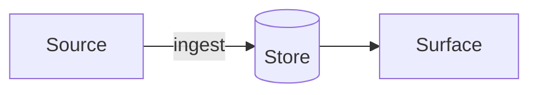

# ADR-NNNN: Short imperative title

- **Status:** 🔴 Proposed
- **Priority:** High | Medium | Low
- **Scope:** S | M | L
- **Created:** YYYY-MM-DD
- **Roadmap:** [ROADMAP.md](../../ROADMAP.md)

## Context

Why now: the problem, evidence from the code (file:line refs), what this
depends on and what depends on it.

## Decision

Numbered list of what will be done.

**Non-goals.** Explicitly out of scope.

## High-Level Architecture

Affected components and flows. Include a Mermaid diagram when the change
touches more than one component.

## Data Model Changes

One subsection per store; write "None" where untouched.

### Postgres

Tables/columns, migration file names, indexes, backfills.

### Graph (Neo4j)

Node labels, relationships, properties, index/constraint changes,
rebuild/projection implications.

### Redis

Keys/structures, TTLs, eviction implications.

## Implementation Details

Concrete plan: files, jobs, wiring, sequencing (e.g., deploy order). Written
before building; corrected here if the plan changes mid-build.

## Consequences & Risks

Blast radius, tradeoffs, data-quality caveats, follow-up ADRs enabled or
required.

## Verification

Gates run (typecheck/lint/tests/build), manual checks performed, and pending
user/prod actions — each marked ⏸ until cleared.

## Implementation Log

- YYYY-MM-DD — Append-only entries: what actually shipped vs. the plan,
  deltas, deferrals, status corrections. Never rewrite Context/Decision after
  completion; a direction change gets a new superseding ADR.
